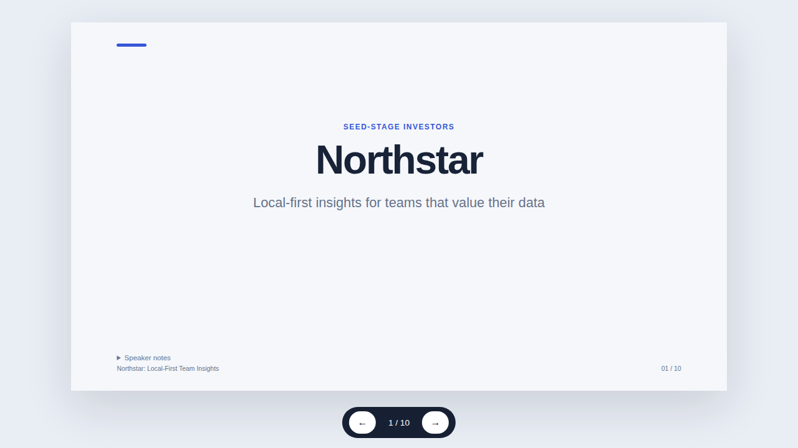
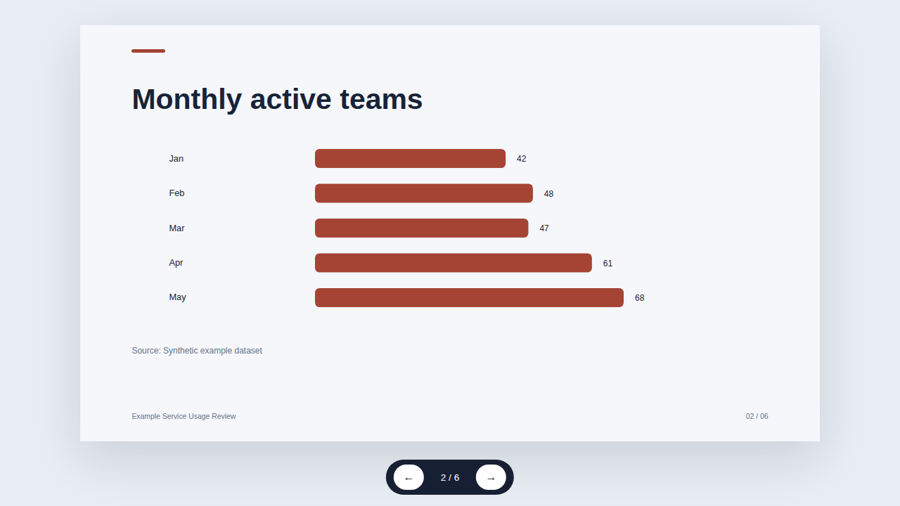

# Agentic Slides


A small, local-first toolkit that turns a structured JSON presentation into an **editable PowerPoint deck** and a **standalone HTML presentation**. Use an AI assistant to draft the JSON if you want, or write it yourself. The renderer makes no model calls and requires no API key.



*Screenshot: title slide generated from `examples/business-pitch.json`, rendered locally in Chrome; example content and numbers are explicitly illustrative.*



*Screenshot: chart slide generated from the six-slide data example; the source label identifies synthetic values.*

## What works today

- Versioned JSON input with eight slide types: title, bullets, metric, process, chart, comparison, quote, and closing.
- Deterministic shared themes and layouts.
- PPTX output with native editable text, shapes, a native editable bar chart, and speaker notes.
- Standalone HTML with inline styles, SVG chart, keyboard navigation, slide counter, notes disclosure, and print CSS.
- Structural validation and heuristic checks for contrast, long text, duplicate titles, and content density.
- No model API, server, database, Docker, external image download, or paid service required.

## Try it

Requirements: Node.js 20+. Then:

```bash
npm install
npm test
npm run generate -- --input examples/business-pitch.json --out out
```

Open the generated `.html` in a browser or `.pptx` in PowerPoint/LibreOffice. See [installation](docs/installation.md) and [usage](docs/usage.md) for all commands.

## Included sample decks

| Sample | Specification | Generated PPTX | Generated HTML | Slides |
|---|---|---|---|---:|
| Investor pitch (illustrative) | [JSON](examples/business-pitch.json) | [PPTX](examples/generated/northstar-local-first-team-insights.pptx) | [HTML](examples/generated/northstar-local-first-team-insights.html) | 10 |
| Beginner AI overview | [JSON](examples/educational-ai.json) | [PPTX](examples/generated/ai-language-models-a-beginner-s-guide.pptx) | [HTML](examples/generated/ai-language-models-a-beginner-s-guide.html) | 8 |
| Synthetic data report | [JSON](examples/data-report.json) | [PPTX](examples/generated/example-service-usage-review.pptx) | [HTML](examples/generated/example-service-usage-review.html) | 6 |

The pitch and chart values are fictional examples for renderer testing; do not treat them as real market or customer evidence.

## How it differs from nearby approaches

This is a scope comparison based on project documentation, **not an output-quality benchmark**.

| Approach | Emphasis in source documentation | Agentic Slides MVP |
|---|---|---|
| [Presentation Forge](https://github.com/Deepnar/presentation-forge) | AI-assisted structured content with deterministic layout and visual review | No model/runtime; JSON-to-PPTX and HTML, with basic structural checks |
| [ppt-agent](https://github.com/Liyilin66/ppt-agent) | Research/source retrieval, citations, and numeric validation | No retrieval or fact-checking; user supplies/validates content |
| [slide-wright](https://github.com/arifszn/slide-wright) | Preview-first design and multiple export paths | Direct reproducible output; native PPTX shapes/chart and standalone HTML |
| [slides_maker](https://github.com/addsumtech/slides_maker) | Agent-driven source conversion and rich native PPTX | Smaller, schema-first layout set; no model or source conversion |

No same-brief comparison was run; this project makes no superiority claim. More evidence is in [the research landscape](research/repository-landscape.md), [deep analysis](research/deep-analysis.md), and [opportunity analysis](research/opportunity-analysis.md).

## Copyable AI workflow

1. Copy [`prompts/master-presentation-prompt.md`](prompts/master-presentation-prompt.md) into ChatGPT, Claude, Gemini, or another assistant.
2. Replace the request and source-material sections; ask for JSON only.
3. Save the response and run `node src/cli.js validate --input presentation.json`.
4. Review QA warnings and verify every factual claim.
5. Generate both formats with `node src/cli.js generate --input presentation.json --out out`.

The JSON contract and renderer are model-independent. Chat interfaces may support different structured-output features. The included [`SKILL.md`](skills/presentation-generator/SKILL.md) is plain Markdown; platform-specific skill discovery and installation paths vary.

## Research and prompt resources

- [30-repository landscape](research/repository-landscape.md) — dated GitHub metadata and evidence classes.
- [Deep analysis of ten projects](research/deep-analysis.md) — architecture and documented strengths/limits.
- [Opportunity analysis](research/opportunity-analysis.md) — prioritized feature decisions.
- [Cross-platform compatibility](research/cross-platform-compatibility.md) — model-neutral JSON vs platform-specific skill installation.
- [Validation and benchmark record](research/benchmark-results.md) — measured local checks and explicitly pending third-party comparisons.
- [Master prompt](prompts/master-presentation-prompt.md) plus [pitch](prompts/pitch-deck.md), [business](prompts/business-presentation.md), [data](prompts/data-presentation.md), and [educational](prompts/educational-slides.md) prompts.
- [Presentation Generator skill](skills/presentation-generator/SKILL.md), [`AGENTS.md`](AGENTS.md), and [docs](docs/).
- [Medium content plan](marketing/medium-content-plan.md) and [solo-creator roadmap](ROADMAP.md).

## Limits

- The toolkit does not generate content with an AI model; model use is optional and external.
- No internet research, citation verification, image generation, PDF export, animation, or automatic visual correction.
- Quality checks are heuristics, not rendered text measurements or aesthetic judgments.
- Fonts/rendering can differ across PowerPoint, LibreOffice, and browsers. Inspect outputs in the applications you plan to use.
- Research metadata is a snapshot (2026-11-02); stars and repository timestamps change.

## License and credits

Original project files are offered under the MIT License in [`LICENSE`](LICENSE). PptxGenJS is a separate MIT-licensed dependency recorded in `package-lock.json`. Research links identify third-party repositories; no third-party source code, prompts, screenshots, themes, or sample deck assets have been copied into this project. External product/project names and marks belong to their respective owners. See [CONTRIBUTING.md](CONTRIBUTING.md) and the research notes before reuse.

## Roadmap

See [`ROADMAP.md`](ROADMAP.md) for honest current status and a $0, 30-minutes-a-day creator plan. Public publication and repository creation are intentionally not performed without explicit approval.
